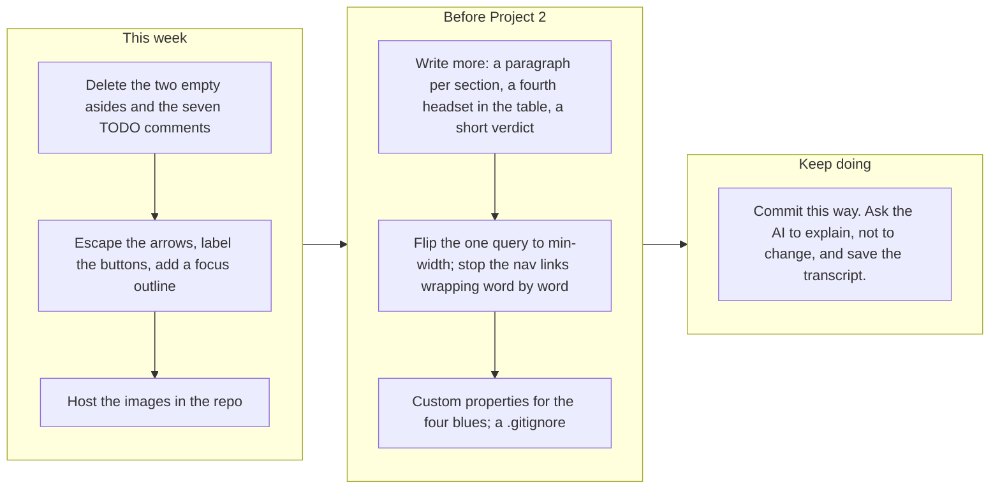

# Project 1: Static Foundations. Feedback for Dennis Dzhidzhora

**Student:** Dennis Dzhidzhora · **Course:** CSC 436, Fall 2026 · **Reviewed at commit:** [`aa8458d`](https://github.com/dennisdzhidzhora22/CSC436-Project-1/commit/aa8458d3978d4c5a1b5f4b07bcf5a476fd4f79d5)
**Repo:** https://github.com/dennisdzhidzhora22/CSC436-Project-1 · **Live:** https://ddzh-csc436-project-1.netlify.app/

> **How this review was made.** Your instructor reviewed this project with Claude (Anthropic's AI) as a second set of eyes. Claude cloned the repo, read all 198 lines of HTML, CSS and JavaScript and the AI transcript you included, ran the W3C validator, loaded the live site in real viewports at 320, 375, 768 and 1280 pixels, clicked through the image carousel in both directions to check the wraparound and the alt text, checked each of the five hotlinked image URLs, compared the live site to the repo, and read all sixteen commits. Every note below was read and approved by your instructor. **Your grade is posted in Brightspace, not here.** This file is the reasoning behind it.

## The short version

This is a small, correct page, and the repository around it is done properly. Sixteen commits over three days, each one a single change with a message that says exactly what it was: "fix: issue with default min width on comparison table causing horizontal scroll on whole page," "add JavaScript for image selector button functionality." The README has all four items. You included the AI transcript the brief asks for, and it shows the right way to use the tool: you described a bug, asked for an explanation rather than a fix, then pushed back on the advice you did not need. That is the model.

The page itself has `header`, a list `nav`, `main`, four `article`s, and a `footer`, with one `h1` and an `h2` on each article. The comparison table has proper `th` cells with `scope`. The body is a real CSS Grid with named areas, the carousel is a nested Grid, and the header is Flexbox. The image switcher wraps around correctly in both directions and updates the alt text with each picture, which most students forget. Nothing scrolls sideways at 375, 768 or 1280.

What holds it back is mostly that it is thin, and a few things were left in. The content is one paragraph, five bullets, a three-row table and five pictures. Two empty `<aside>` elements exist only to create side margins. The seven `TODO` comments from the starter template are still in the file. The arrow buttons contain a raw `<`, which is the page's one validator error, and have no accessible name. All five carousel images are hotlinked from other sites, and one of them is a Reddit preview URL with a signed token that will stop working. There are no custom properties, no focus styles, and the single media query is desktop-first. The work was also completed after the deadline, which your instructor is handling separately.

## What the numbers looked like

| Check | Result |
|---|---|
| W3C HTML validator | 1 error (unescaped `<` inside the left button), 1 info note |
| Horizontal scroll at 375 / 768 / 1280 px | None. At 320 px the page is 22 px wider than the screen |
| Heading order | One h1, three h2, no skipped levels; the carousel article has no heading |
| Semantic elements | header, nav (ul of 3), main, 4 article, footer, table with `th scope`; **2 empty aside** |
| Layout | Grid on `body` with named areas, Grid on `main`, Grid on the carousel; Flexbox on the header and nav |
| Media queries | 1, `max-width: 680px` (desktop-first) |
| Custom properties / focus styles | 0 / 0 |
| Carousel | 5 images; right five times returns to the first; left from the first goes to the fifth; alt text changes with each |
| Carousel buttons | Text content `<` and `>`, no `aria-label`, no `type` |
| Images | 5, all hotlinked: Steam CDN ×2, The Verge, Reddit preview (signed URL), GamingBolt; 51 KB to 478 KB; none in the repo |
| Template comments | 7 `TODO` comments left in `index.html` |
| Console errors | 0 |
| Commits | 16: one README-only commit Sep 15, then 15 commits Sep 19 to 21, each a single change |
| README | Title, description, how to run, live URL: all four |
| AI transcript | Included in `ai_transcripts/`; asks for explanation, not changes |
| Live vs repo | Identical |

---

## Semantic HTML

### What's working

- The skeleton is right: `<header>` holding the `h1` and a `<nav>` with a `<ul>` ([index.html#L12-L21](https://github.com/dennisdzhidzhora22/CSC436-Project-1/blob/aa8458d3978d4c5a1b5f4b07bcf5a476fd4f79d5/index.html#L12-L21)), `<main>` with an `<article>` per block, each with its own `h2`, and a `<footer>` with your name and the semester. The spec list is a real `<ul>`. The comparison table uses `<thead>`, `<th scope="col">` for the columns and `<th scope="row">` for each device ([#L49-L82](https://github.com/dennisdzhidzhora22/CSC436-Project-1/blob/aa8458d3978d4c5a1b5f4b07bcf5a476fd4f79d5/index.html#L49-L82)), which is the correct, and rarely seen, way to mark up a data table. The image has alt text, and the script keeps it accurate as the picture changes.

### What to change

- **Two empty `<aside>` elements** ([#L25-L26](https://github.com/dennisdzhidzhora22/CSC436-Project-1/blob/aa8458d3978d4c5a1b5f4b07bcf5a476fd4f79d5/index.html#L25-L26), [#L91-L92](https://github.com/dennisdzhidzhora22/CSC436-Project-1/blob/aa8458d3978d4c5a1b5f4b07bcf5a476fd4f79d5/index.html#L91-L92)). They contain nothing and exist only to be the `1fr` side tracks of the body grid. `aside` means "content tangentially related to the main content" and it is a landmark, so a screen reader announces two empty complementary regions. Delete them and give `main` a `max-width` with `margin-inline: auto`, or keep the three-column grid and put nothing in the outer tracks. Same look, honest markup.

  ```mermaid
  flowchart TB
    A["body is a Grid: 1fr, 10fr, 1fr with named areas head, l main r, foot"]
    A --> B["The two 1fr tracks are empty aside elements. They exist only to make margins."]
    B --> C["A screen reader announces two empty complementary landmarks before and after the content"]
    C --> D["Fix: delete both asides. Give main a max-width and margin-inline auto, or use 1fr minmax(0, 60rem) 1fr with main placed in the middle track. Same look, two fewer landmarks."]
  ```

- **The arrow buttons** ([#L86](https://github.com/dennisdzhidzhora22/CSC436-Project-1/blob/aa8458d3978d4c5a1b5f4b07bcf5a476fd4f79d5/index.html#L86), [#L88](https://github.com/dennisdzhidzhora22/CSC436-Project-1/blob/aa8458d3978d4c5a1b5f4b07bcf5a476fd4f79d5/index.html#L88)). A raw `<` in HTML is the validator's one error; write `&lt;` and `&gt;`. The `<b>` inside is styling, not meaning; use CSS. And a button whose only content is a symbol has no name for a screen reader, so add `aria-label="Previous image"` and `aria-label="Next image"`, plus `type="button"`.
- **Seven `TODO` comments from the starter file are still in the page** ([#L6](https://github.com/dennisdzhidzhora22/CSC436-Project-1/blob/aa8458d3978d4c5a1b5f4b07bcf5a476fd4f79d5/index.html#L6), [#L11](https://github.com/dennisdzhidzhora22/CSC436-Project-1/blob/aa8458d3978d4c5a1b5f4b07bcf5a476fd4f79d5/index.html#L11), [#L23-L24](https://github.com/dennisdzhidzhora22/CSC436-Project-1/blob/aa8458d3978d4c5a1b5f4b07bcf5a476fd4f79d5/index.html#L23-L24), [#L94-L98](https://github.com/dennisdzhidzhora22/CSC436-Project-1/blob/aa8458d3978d4c5a1b5f4b07bcf5a476fd4f79d5/index.html#L94-L98)). Anyone who views source sees the assignment checklist. Delete them once each one is done, which they are.
- Small: the carousel `article` has no heading, which the validator notes. A visually hidden `<h2>Photos</h2>` fixes it, or make that block a `<figure>` instead of an `<article>`.

## CSS layout

### What's working

- **Grid with named areas on the body** ([styles.css#L3-L15](https://github.com/dennisdzhidzhora22/CSC436-Project-1/blob/aa8458d3978d4c5a1b5f4b07bcf5a476fd4f79d5/styles.css#L3-L15)). `grid-template-areas` with `head`, `l main r`, `foot` is the most readable way to describe a page layout, and it is yours. `main` is its own Grid with a gap so the cards stack evenly, and the carousel is a third Grid, `1fr 20fr 1fr`, so the arrows hug the picture ([#L62-L65](https://github.com/dennisdzhidzhora22/CSC436-Project-1/blob/aa8458d3978d4c5a1b5f4b07bcf5a476fd4f79d5/styles.css#L62-L65)). The header is Flexbox with `space-between` and the nav list is Flexbox with `gap`. `box-sizing: border-box` on everything, `min-width: 0` on the grid items so the table cannot blow the page open, and `overflow-x: auto` on the cards so the table scrolls inside its box ([#L58-L60](https://github.com/dennisdzhidzhora22/CSC436-Project-1/blob/aa8458d3978d4c5a1b5f4b07bcf5a476fd4f79d5/styles.css#L58-L60)). That last pair is the fix from your AI transcript, applied correctly.

### What to change

- **No custom properties, and the palette is typed by hand.** Four blues and one grey appear across the file with no names. Put them in `:root` and the next theme change is one edit. Related: `.site-header` and `.site-footer` each declare `background` twice ([#L23-L24](https://github.com/dennisdzhidzhora22/CSC436-Project-1/blob/aa8458d3978d4c5a1b5f4b07bcf5a476fd4f79d5/styles.css#L23-L24), [#L32-L33](https://github.com/dennisdzhidzhora22/CSC436-Project-1/blob/aa8458d3978d4c5a1b5f4b07bcf5a476fd4f79d5/styles.css#L32-L33)); the first `#bbbbbb` is dead and should go.
- **No focus styles.** Tab to the nav links and the arrow buttons: the browser default ring on a navy background is hard to see. One `:focus-visible` rule with a 3 px outline in your light blue covers every interactive element.
- **The empty side tracks are doing a margin's job.** `1fr 10fr 1fr` is a clever way to center content, but it means the content width is always 10/12 of the screen, which is 1,066 px on a 1280 display. A `max-width: 70rem` on `main` would read better on wide screens and would not need the two empty asides.
- Small: the table borders are declared on `td`, `tr` and `th` separately, with the same values each time; `table, th, td { border: 1px solid #999 }` is one rule.

## Responsive design

### What's working

- No horizontal scroll at 375, 768 or 1280. Below 680 px the outer grid tracks collapse to zero and the content takes the full width, and the comparison table scrolls inside its card instead of stretching the page, which is the exact bug you diagnosed and fixed on September 20.

### What to change

- **The nav links wrap word by word on a phone.** At 375 px "Steam Store Page" becomes three stacked words, and the three links sit as three narrow columns next to the title ([styles.css#L26](https://github.com/dennisdzhidzhora22/CSC436-Project-1/blob/aa8458d3978d4c5a1b5f4b07bcf5a476fd4f79d5/styles.css#L26)). Let the list wrap as whole items: `flex-wrap: wrap` on the `ul` and `white-space: nowrap` on the links, or stack the header into a column under 680 px the way the body already changes there.
- **Desktop-first, single query.** The one media query is `max-width: 680px` ([#L17-L21](https://github.com/dennisdzhidzhora22/CSC436-Project-1/blob/aa8458d3978d4c5a1b5f4b07bcf5a476fd4f79d5/styles.css#L17-L21)). The brief asks for mobile-first: make the single-column layout the base and add the side tracks inside a `min-width` query.
- At 320 px the page is 22 px wider than the screen. The brief's bar is 375, so this is a note, not a deduction; the header's title and three links are the likely cause.

## JavaScript interaction

### What's working

- **The carousel is correct and compact** ([script.js#L14-L24](https://github.com/dennisdzhidzhora22/CSC436-Project-1/blob/aa8458d3978d4c5a1b5f4b07bcf5a476fd4f79d5/script.js#L14-L24)). The modulo arithmetic wraps in both directions, including going left from the first image, and Claude clicked right five times and landed back on the first picture. Each entry pairs a URL with its own alt text, and the handler updates both, so the description is never stale. Twenty-three lines, no errors, no libraries.

### What to change

- **One feature, and the smallest version of it.** The brief asks for at least one interaction, and this is exactly one. Two cheap upgrades: show "2 of 5" under the picture so the visitor knows there are five, and let the arrow keys move it (`keydown` on `document`, check `event.key`). A caption from the alt text would make the pictures mean something.
- **The two handlers are the same function with a different sign.** Write one `showImage(delta)` and call it with `-1` and `+1`. Also `currentImg` should be `let`, not `var`.
- **Nothing is preloaded.** Each click fetches an image from another site for the first time, so the picture visibly pops in. `new Image().src = nextUrl` after each click, or all five at load, removes the wait.

## Repository and deployment

### What's working

- **Sixteen commits, each one a single change, each message precise.** "add responsive column widths for mobile devices," "adjust `<td>` cell background color for better contrast," "add hover styling to navbar links." This is the habit the brief asks for, and it is fully formed. The README has the title, a real description, two ways to run the project, and the live link. The live site matches the repo exactly, and it is on Netlify as the brief specifies.
- **You included the AI transcript** ([ai_transcripts/](https://github.com/dennisdzhidzhora22/CSC436-Project-1/tree/aa8458d3978d4c5a1b5f4b07bcf5a476fd4f79d5/ai_transcripts)), which the brief asks for and almost nobody did. The conversation itself is a good example: a precise description of the symptom, an explicit "do not make changes, explain," and then a follow-up question that caught the tool recommending something you did not need. Keep doing exactly that.

### What to change

- **The timing.** The first commit on September 15 is a two-line README; all of the site was built September 19 to 21, after the deadline. Your instructor is applying the late penalty separately, and your note about it was noted. The history itself is not the problem; the calendar is.
- Small: there is no `.gitignore`. Add one with `.DS_Store`, `.vscode/` and `node_modules/` before the first time one of them sneaks in.

## Content and polish

### What's working

- A real subject with real numbers: the specs are the published ones, the comparison table pits the Frame against the two headsets people actually cross-shop, and the nav goes to the store page, the compatibility list and a real review. The navy-and-blue palette is consistent, the cards read cleanly, and the footer is signed.

### What to change

- **All five images live on other people's servers** ([script.js#L2-L6](https://github.com/dennisdzhidzhora22/CSC436-Project-1/blob/aa8458d3978d4c5a1b5f4b07bcf5a476fd4f79d5/script.js#L2-L6)). Two are on Steam's CDN, one on The Verge, one on GamingBolt, and one is a Reddit preview URL carrying a signed `s=` token, which Reddit rotates; that link will break. The brief asks for real images in your project. Download the five, resize them to about 1200 px wide, put them in an `images/` folder, and reference them locally. Then add `width`, `height` and `loading="lazy"` to the `img`.

  ```mermaid
  flowchart LR
    subgraph today["Where the five carousel images live today"]
      direction TB
      t1["Steam CDN, 51 KB"] ~~~ t2["Steam CDN, 268 KB"]
      t2 ~~~ t3["The Verge, 267 KB"]
      t3 ~~~ t4["Reddit preview with a signed s= token, 478 KB. Tokens expire."]
      t4 ~~~ t5["GamingBolt, 142 KB"]
    end
    subgraph after["After"]
      direction TB
      a1["images/ folder in your repo, five files resized to 1200 px, under 150 KB each"] ~~~ a2["Nothing breaks when another site moves a file"]
      a2 ~~~ a3["loading=lazy on the img, width and height set, and the next image preloaded when a button is pressed"]
    end
    today --> after
  ```

- **There is not much to read.** One sentence about what the Frame is, five bullets, three table rows. A paragraph on who it is for, a paragraph on how it compares in practice, a fourth and fifth row in the table, and a short verdict would make this an info page rather than a spec sheet.
- Small: the raw `<` and `>` as arrow glyphs look like placeholders. A pair of SVG chevrons, or even `‹` and `›`, reads as designed.

---

## Your next moves



1. **Clean the markup.** Remove the empty asides and the TODO comments, escape the arrows, label the buttons, add a focus rule. Twenty minutes, and the validator goes to zero.
2. **Own the images.** Five files in an `images/` folder, sized and lazy-loaded. The Reddit one will break otherwise.
3. **Fill it in.** More words, more rows, a caption under the carousel. The structure is ready for it.

*This review lives in a pull request on your repo. It only adds files under `feedback/` and does not touch your code. Merge it, close it, or just read it. Your grade is in Brightspace. Questions go to office hours or the Brightspace board. The process here is already professional, Dennis; the page just needs more of you in it.*
